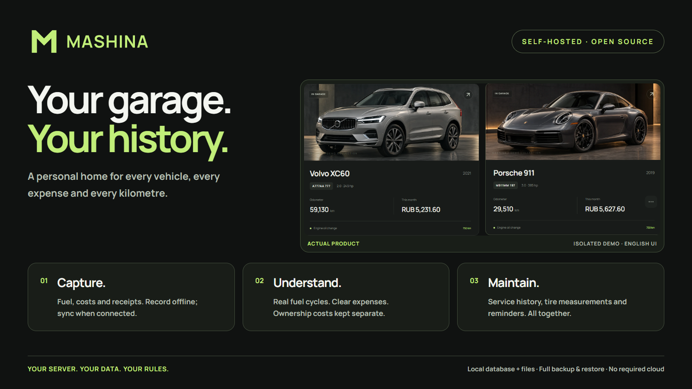
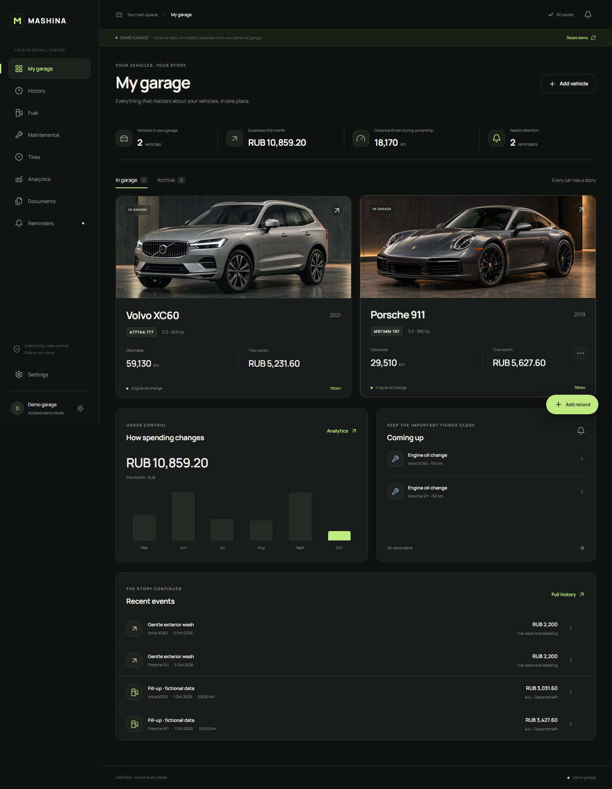
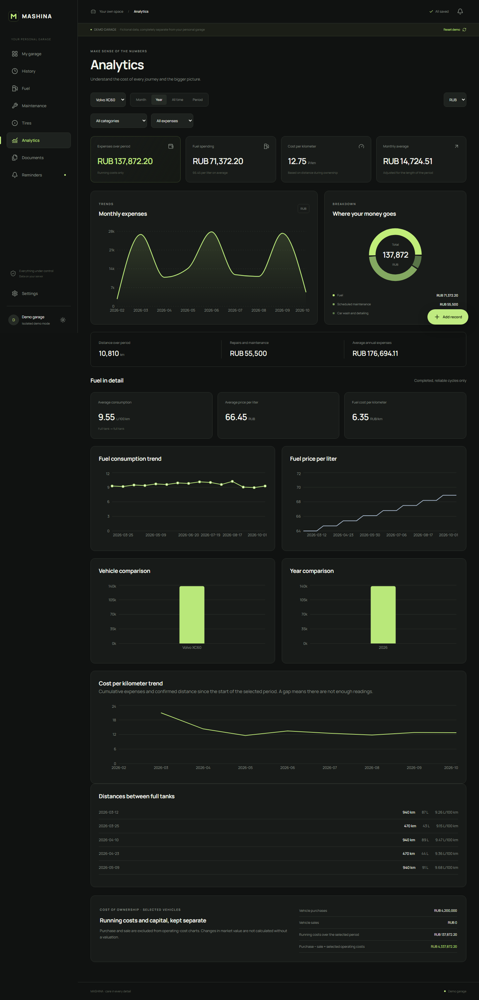

  

  <strong>Your garage. Your history. Your server.</strong> 
  A personal home for your cars, expenses, fuel and maintenance.

  English · <a href="README.ru.md">Русский</a> ·
  <a href="https://github.com/kosavan/mashina/releases">Releases</a> ·
  <a href="docs/self-hosting.md">Install</a> ·
  <a href="docs/testing-release.md">macOS &amp; Windows testing</a>

## A garage worth keeping up to date

- **Every vehicle, one history.** Photos, ownership, mileage, service, parts and private documents.
- **Quick fuel and expense entry.** Exact money, itemized costs, receipts and vehicle-specific defaults.
- **Analytics you can trust.** Full-to-full fuel consumption, separate purchase/sale values and clear missing-data states.
- **Tires deserve their own space.** Mounting history, manufacture codes, dated tread measurements and care guidance.
- **Built for your phone.** Dark/light themes, touch-friendly controls and an installable PWA. English and Russian UI, selectable at setup and in Settings.
- **Local by default.** Durable offline entries, safe synchronization, SQLite + local files and complete backup/restore.

Sharing, budgets, sale-history PDFs and reviewed CSV imports are included. Notifications and a scoped API/local MCP are optional. Service addresses stay local; external maps load only when you choose. No required cloud, paid API or telemetry.

## Try it before adding your own data

Start MASHINA and choose **«Посмотреть демогараж»** on the welcome screen. Explore two fictional vehicles, costs, fuel, tires and service history. Each demo session has its own temporary database and files, isolated from your real garage.

See the actual garage and analytics

## Self-host in a few commands

Linux with Docker Engine + Compose:

~~~sh
git clone https://github.com/kosavan/mashina.git
cd mashina
cp .env.example .env
mkdir -p data
sudo chown 10001:10001 data
docker compose up -d --build
docker compose exec mashina /app/.venv/bin/python -m backend.cli create-admin
~~~

Open **http://localhost:8000**. Your data live in **./data**. Use HTTPS for remote access and iPhone PWA installation.

**[Full deployment & backup guide](docs/self-hosting.md)** · **[macOS Terminal / Windows PowerShell](docs/testing-release.md)**

## Under the hood

React + TypeScript + Vite · FastAPI · SQLite/WAL · local attachments. A modular monolith in one non-root application container, designed for a small home server.

**[Development & tests](docs/development.md)** · **[Architecture](specs/001-mashina-platform)** · **[Fuel capture](docs/fuel-capture.md)** · **[Tires & service locations](docs/tires-and-locations.md)** · **[API & MCP](docs/machine-access.md)**

Receipt recognition, natural-language history search, an expense-entry bot and OBD-II are still future work. They are not hidden behind working-looking controls.

Built with [Spec Kit](https://github.com/github/spec-kit); identity developed with [logo-design-skill](https://github.com/kaankiziltug/logo-design-skill), infographic authored with [Hyperframes](https://github.com/heygen-com/hyperframes).

Vibecoded with love ❤️
