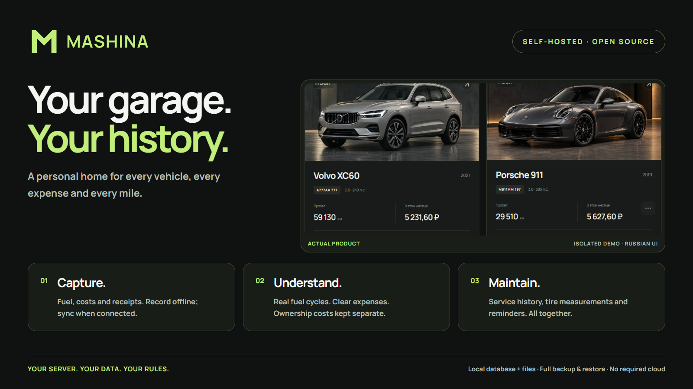
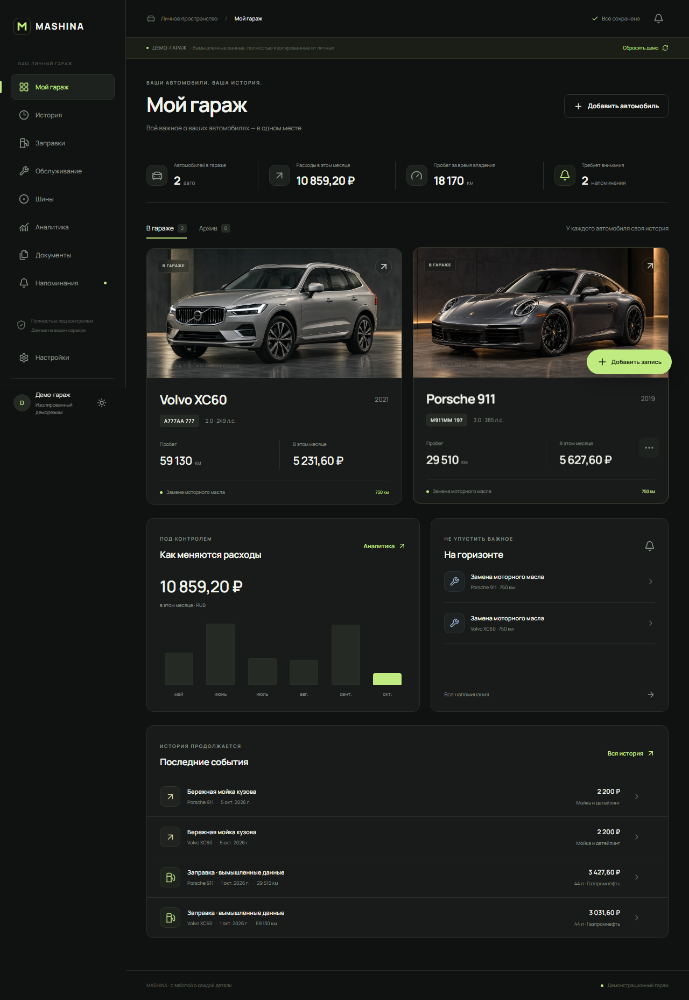
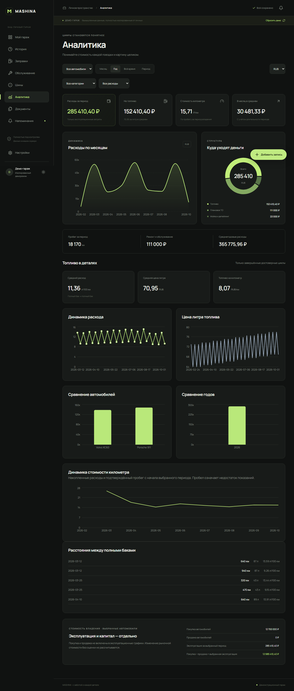

  

  <strong>Ваш гараж. Ваша история. Ваш сервер.</strong> 
  Персональный дом для автомобилей, расходов, заправок и обслуживания.

  <a href="README.md">English</a> · Русский ·
  <a href="https://github.com/kosavan/mashina/releases">Релизы</a> ·
  <a href="docs/testing-release.md">Установка и проверка на Mac / Windows</a>

## Гараж, историю которого хочется вести

- **Каждый автомобиль — отдельная история.** Фотографии, владение, пробег, ТО, запчасти и личные документы.
- **Быстрые заправки и расходы.** Точные суммы, позиции, чеки и последние АЗС/топливо выбранной машины.
- **Понятная аналитика.** Расход от полного бака до полного, покупка и продажа отдельно, честные состояния недостаточных данных.
- **Отдельный раздел шин.** Установки, DOT, история замеров протектора и рекомендации по уходу.
- **Удобно с телефона.** Тёмная и светлая темы, большие кнопки, устанавливаемое PWA и русский интерфейс.
- **Данные под вашим контролем.** Офлайн-записи, безопасная синхронизация, SQLite, локальные файлы, полный бэкап и восстановление.

Есть совместный доступ, бюджеты, PDF-история для продажи и проверяемый CSV-импорт. Уведомления и ограниченный API/локальный MCP подключаются по желанию. Адреса сервисов остаются локальными; внешняя карта загружается только по нажатию. Обязательных облаков, платных API и телеметрии нет.

## Попробовать без личных данных

После запуска нажмите **«Посмотреть демогараж»**. Два вымышленных автомобиля, расходы, заправки, шины и обслуживание доступны в отдельной временной базе с собственными файлами. Демо не связано с вашим настоящим гаражом.

Гараж и аналитика

## Запустить у себя

Linux с Docker Engine и Compose:

~~~sh
git clone https://github.com/kosavan/mashina.git
cd mashina
cp .env.example .env
mkdir -p data
sudo chown 10001:10001 data
docker compose up -d --build
docker compose exec mashina /app/.venv/bin/python -m backend.cli create-admin
~~~

Откройте **http://localhost:8000**. Данные находятся в **./data**. Для удалённого доступа и установки на iPhone нужен HTTPS.

**[Mac: Terminal / Windows: PowerShell — пошагово](docs/testing-release.md)** · **[Подробная инструкция](docs/handbook.ru.md)** · **[Развёртывание и бэкапы, EN](docs/self-hosting.md)**

## Подробнее

React + TypeScript + Vite · FastAPI · SQLite/WAL · локальные вложения. Модульный монолит в одном контейнере без root, рассчитанный на домашний сервер.

**[Разработка и тесты](docs/development.md)** · **[Архитектура](specs/001-mashina-platform)** · **[Как быстрее заводить заправки](docs/fuel-capture.md)** · **[Шины и адреса сервисов](docs/tires-and-locations.md)** · **[API / MCP](docs/machine-access.md)**

Распознавание чеков, поиск по истории обычным языком, бот внесения расходов и OBD-II пока не реализованы. Незавершённые функции не выдаются за готовые.

Разработка через [Spec Kit](https://github.com/github/spec-kit); логотип — с [logo-design-skill](https://github.com/kaankiziltug/logo-design-skill), инфографика — с [Hyperframes](https://github.com/heygen-com/hyperframes).
